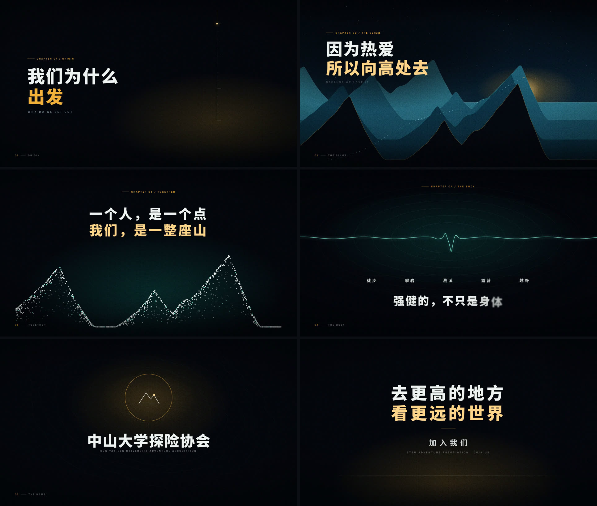

# 向高处去 · 中山大学探险协会 40 秒动态图形宣传片

> 一部纯程序化的动态图形短片：画面里没有一张外部图片、一段视频、一个字体文件。
> 山脊、粒子聚山、心电脉冲、等高线地形，全部由确定性噪声在每一帧实时计算。


`1920 × 1080` · `30 fps` · `40.000 s / 1200 帧` · `H.264 + AAC` · `Remotion 4` · `TypeScript`

---

## 关于

中山大学探险协会的宣传片。核心是一句话：**因为热爱，所以向高处去。**

片子没有讲社团历史，也没有罗列活动清单。它只做一件事——把"向上"这个动作，
在六个尺度上各演一遍：一点微光、一条山脊、一群聚成山的点、一次心跳、
一片旋转的等高线、一条地平线。看完你记住的是一个方向，而不是一堆信息。

## 预览



## 章节

| # | 时间 | 章节 | 画面 | 文案 |
|---|------|------|------|------|
| 01 | 0.0–4.4s | ORIGIN | 一点微光在黑暗中升起，拉开一条向上的竖线 | 我们为什么出发 |
| 02 | 4.0–10.9s | THE CLIMB | 四层山脊由线描生长为剪影，日出，虚线路径蜿蜒登顶 | 因为热爱 / 所以向高处去 |
| 03 | 10.5–17.4s | TOGETHER | 1150 个光点飞入，聚成一整座山，一道光扫过 | 一个人，是一个点 / 我们，是一整座山 |
| 04 | 17.0–23.4s | THE BODY | 心电图被逐点"写"过画面，之后沉为呼吸般的波纹 | 强健的，不只是身体 / 是敢往深处走的底气 |
| 05 | 23.0–30.9s | THE LAND | 等高线地形缓慢旋转，名山大川四字落定 | 名山大川 / 从此，有了我们的脚印 |
| 06 | 30.5–35.9s | THE NAME | 徽记闭合，字标收紧成组 | 中山大学探险协会 |
| 07 | 35.5–40.0s | SET OUT | 地平线收束到黑场 | 去更高的地方，看更远的世界 / 加入我们 |

## 设计说明

**一条主线。** 全片只有一个母题——"向上"。竖线、山脊、上行的虚线、心电的峰值、
等高线、地平线，是同一条线在不同尺度上的六次变奏。观众不需要被解释，只需要被重复。

**一套色系。** 夜蓝（`#04060B → #17414F`）作底，薄荷青（`#79E8D3`）代表身体与生命力，
金色（`#F2B138`）只留给"人"和"热爱"出现的地方——所以它一旦出现，视线就一定跟过去。

**字体层级。** 中文 Noto Sans SC（900 / 700 / 400 / 300），西文 Space Grotesk 全大写宽字距，
用作章节索引与技术标注，形成"片头字幕 + 技术档案"的双声部。

**章节 HUD。** 左下角常驻 `01 / ORIGIN`，是纪录片式的自我说明，也是节奏刻度。

**转场。** 第一版是七个分镜各自淡入淡出，实测全片有约 6 秒是近乎全黑的空拍。
改成各分镜在时间轴上重叠 12 帧交叉溶解、文案随透明度同步退场之后，节奏才立住。

## 技术实现

- **确定性噪声**：`lib/rng.ts` 里是 mulberry32 + 值噪声 + fBm。所有山脊轮廓、
  粒子落点、等高线抖动都由种子决定，因此任意一帧都可以独立复现、独立出图。
- **山脊**：`mountainAltitude()` 用三个不对称的高斯峰叠加再掺入 fBm 细节，
  四层山脊共用同一条天际线的不同缩放与偏移，靠视差和大气透视做纵深。
- **粒子聚山**：1150 个点从画外沿弧线飞入。落点沿山脊线加密（`pow(rand, 3.1)` 的深度偏置），
  保证轮廓清晰而山体通透——否则只会得到一团云。
- **心电**：把 QRS 波群拆成四个高斯脉冲叠在正弦上，"书写"效果由 `clipPath` 矩形
  跟随游标推进实现，而不是逐点描边。
- **等高线**：极坐标采样后叠加两层 fBm 作为半径扰动，整体缓慢旋转。
- **颗粒**：640px 灰度噪声 + `soft-light`。第一版用逐帧随机偏移，视觉上没问题，
  但编码器完全无法利用帧间相关——同样 40 秒，母版 449MB。改成缓慢漂移后降到 150MB，
  画面几乎无差别。

## 快速开始

```bash
npm install
./r.sh studio                                        # 打开 Remotion Studio 预览
./r.sh render src/index.ts Film out/film.mp4 --codec=h264 --crf=17
./r.sh render src/index.ts Film out/frames --frames=240,860 --image-format=png
./make_audio.sh                                      # 重新合成配乐
```

> `r.sh` 只是给 `remotion` 套了一层 `LD_LIBRARY_PATH`。这台机器没有 `libnss3` / `libnspr4`，
> 无头 Chrome 起不来，已把这两个包解到 `/home/charles/opt/chrome-libs`。
> 在依赖齐全的机器上可以直接 `npx remotion ...`，`r.sh` 不是必需的。

## 目录

```
src/
  theme.ts              色板、字体、分镜时间轴
  Film.tsx              全片装配：相机 / 颗粒 / 暗角 / 章节 HUD / 配乐
  copy.ts               所有中文字形的预载样张（CJK 字体必须先加载再渲染）
  FontGate.tsx          delayRender 闸门，等字体真正就绪才放行首帧
  lib/rng.ts            确定性随机、值噪声、fBm
  lib/anim.ts           缓动曲线、进度、错帧、包络
  lib/paths.ts          山脊轮廓、平滑路径、等高线环
  components/Stage.tsx  相机、颗粒、暗角、章节编号
  components/Type.tsx   逐字入场、遮罩揭示、小标
  scenes/               七个分镜，一个文件一个章节
public/                 颗粒纹理、配乐
docs/                   README 用的海报与故事板
```

## 定制

- **改文案**：直接改 `scenes/*.tsx` 里的 `CharReveal` / 文本节点；
  新出现的汉字要同步加进 `src/copy.ts` 的 `GLYPH_SAMPLES`，否则字体子集可能没预载。
- **改颜色**：`theme.ts` 里的 `C` 对象，全片统一引用。
- **改时长**：`theme.ts` 的 `SCENES` 与 `DURATION`。注意相邻分镜要保留 12 帧重叠。
- **换配乐**：替换 `public/score.wav`，或改 `audio.filter` 后重跑 `make_audio.sh`。

## 待补

片尾 `加入我们` 之下目前没有放二维码和联系方式——这类信息属于社团事实，不应该被编造。
正式招新前建议在 `src/scenes/SceneOutro.tsx` 的 CTA 区块补上招新群二维码、
咨询方式或招新时间地点。

## 声明

画面与配乐均为程序化生成，不含任何第三方素材；配乐由 ffmpeg 合成，可随片商用。
片中"中山大学探险协会"名称及相关称谓的使用需获得社团授权。
